# Figures

Every new slide and paper figure, one section each. Write what needs to change under **Comments** of that figure; Claude works through them, applies the change, and clears the comment once it is done. If applicable Claude will use already present code for plotting components, such as `src/paper_figures.py` or `figures/fig1_overview/bftlib.py`, to seed the figure code.

Regenerate from the repo root with `PYTHONPATH=. .venv/bin/python figures/<script>.py`. Slides land in `figures/slides/` (dark), paper figures in `figures/paper/` (light), each with a PNG in `preview/`; the images below are those previews (`slides/preview/`, `paper/preview/`). A slide with builds writes `<name>_1`, `<name>_2`, ... on one canvas, so the builds overlay.

To ask for a new figure, add a section with its message as the heading and what it should show under **Comments**.

Each slide section has a **Notes:** block: the presenter notes that the sync-slides skill writes into the Keynote deck. A paragraph starting with `Build k:` goes to the k-th build of the section only; every other paragraph goes to all its builds. Notes edited in Keynote are never overwritten; clear them there to get the ones from here back.

## Conventions

- Slides are dark (black background) at 1727:818 (`style.SLIDE_AR`, the Keynote frame), paper figures light at AAAI text width. Every color comes from `style.COLOR`, whose keys are the components of `.figstyle/colors.yaml` (even / odd blue / red, BFT purple, ...).
- Slides carry no title inside the figure; the message is the section heading here.
- Little text, no overlapping text. One grey note line under a slide at most.
- Content is centered horizontally on every slide. Consecutive slides that show the same plot keep it at the same position; a slide that grows over builds centers its last build and aligns the earlier ones to it (`publish` in `style.py` centers each such group as one).
- Figures read only the `figures/figdata/` bundles (`figdata.load`, numpy + matplotlib only) or seeded toys.

## Slides

**General Comments:**

The method overview, in talk order, then the results. The method slides are all from `method.py`; apart from the two neuroscience slides they use a toy network with the sizes of the paper's even/odd MLP (8 x 4 x 2 on digits 0, 4, 1, 3), seeded activations and weights, real NMF fits on the toy arbors. Digit rows are ordered 0, 4, 1, 3; blue is even, red is odd, lighter shades are 4 and 3.

### activations: interpretability usually reads a layer's activations and maps them to concepts

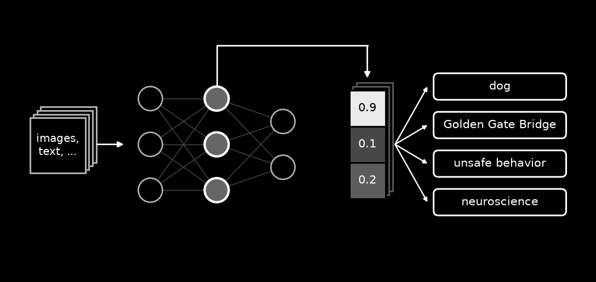

After the inspiration deck: inputs into a network, one layer's activations read out as a vector and mapped to concepts.

**Notes:**

Most interpretability work reads a layer's activations: we push images or text through the network, take one layer's activation vector, and map it to concepts like a dog, the Golden Gate Bridge or unsafe behavior. That treats the activation as the unit of meaning. But an activation is only the result of a computation, the sum of incoming weights times the activations of the layer before. Reading activations alone throws away which weights produced them.

**Comments:**

### neuro_arbor: in neuroscience, a neuron is read through its dendritic arbor, the inputs that converge on it

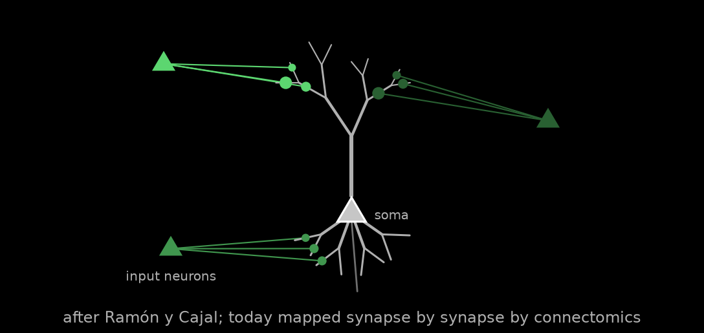

A stylized pyramidal cell: its dendritic arbor (grey) and three input neurons, each contacting the branches nearest to it (one green shade per input, synapse size = strength). Note line: from Ramón y Cajal's drawings to today's synapse-level connectomics.

**Notes:**

In neuroscience, a neuron is read not only through its responses but through its dendritic arbor: which inputs converge on it, where, and how strongly. Here three input neurons, each in its own shade of green, contact the branches nearest to them, and the size of each synapse is its strength. Since Ramón y Cajal's drawings this was done by eye; today connectomics maps it synapse by synapse. BFT carries the same idea over to artificial networks: read a unit through the inputs that actually drive it.

**Comments:**

### neuro_simple_cell: the arbor explains the tuning: a simple cell prefers one orientation because its inputs line up along it

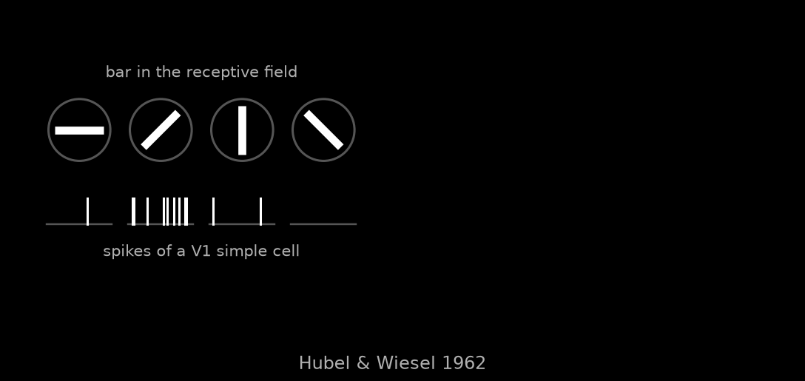
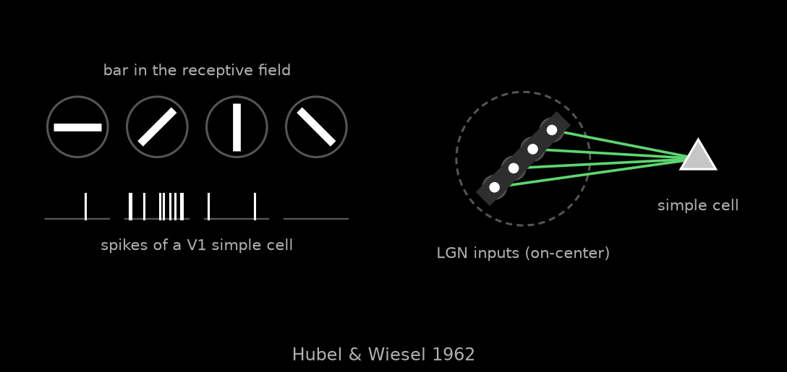

Hubel & Wiesel's (1962) feedforward model of a V1 simple cell. Build 1: bars at four orientations in the receptive field and the cell's spikes; it fires for the 45° bar. Build 2: the explanation from its arbor: on-center LGN inputs whose receptive fields lie along that 45° line (the preferred bar drawn faintly behind them), all wired onto the cell (green, the trace color of the method slides).

**Notes:**

Build 1: The classic example is the V1 simple cell of Hubel and Wiesel. We show bars at four orientations in its receptive field. The cell fires a little for the horizontal and the vertical bar, strongly for the 45 degree bar, and not at all for the other diagonal. From the responses we know what it prefers, but not why.

Build 2: The explanation came from its arbor: the cell receives on-center LGN inputs whose receptive fields lie along a 45 degree line, so a bar at that angle excites all of them at once. The tuning follows from which inputs converge on the cell. That is the kind of explanation we want for units in a network, and the green is the color the traces have on the method slides.

**Comments:**

### arbor: the same activation can come from different inputs

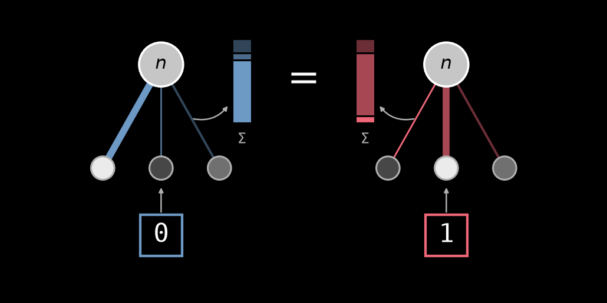

One neuron $n$ reached by a "0" and by a "1" through different weight x activation terms (edge width, one shade per input), stacked into the same sum (bars, facing each other across the =).

**Notes:**

Here is why that matters. Neuron n responds to a 0 and to a 1 with the same activation: the stacked bars on both sides of the equals sign have the same height. But the 0 drives it mostly through the left input and the 1 through the middle one. The individual weight x activation terms differ, only their sum is the same. From the activation alone the two cases look identical; BFT keeps the individual terms, so it can tell them apart.

**Comments:**

### toy_task: an MLP sorts the digits 0, 1, 3, 4 into even and odd

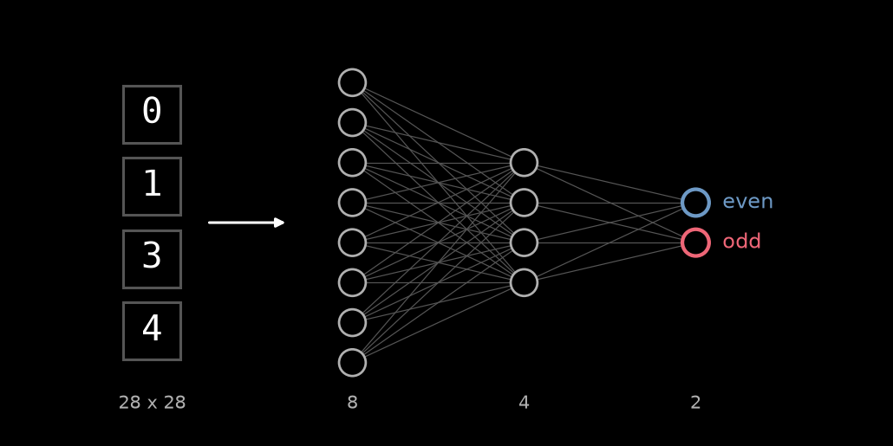

**Notes:**

To explain the method I use a toy network with the sizes of the even/odd MLP from the paper: 28 x 28 pixel inputs, hidden layers of 8 and 4 units, and two outputs, even and odd. It is trained on the digits 0, 1, 3 and 4. On the method slides blue is even and red is odd; the lighter shades mark the 4 and the 3.

**Comments:**

### overview: BFT asks what drives an output, splits it into circuits, and traces each circuit back

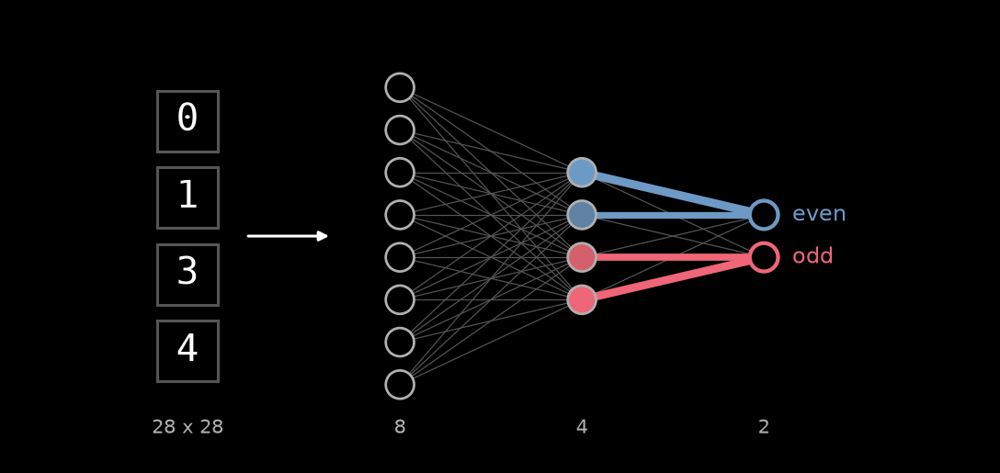
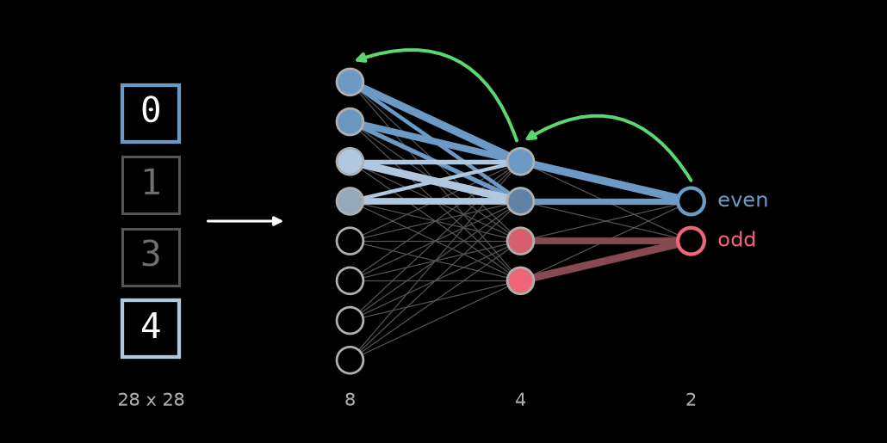

The toy_task slide, unchanged in layout, with the method drawn on it (the three slides overlay). Build 1: what drives each output splits into circuits, even (blue) and odd (red). Build 2: the even circuit traced back (green) splits again into a "0" and a "4" sub-circuit; the 0 and 4 inputs light up.

**Notes:**

Build 1: BFT starts at the output. It asks what drives each output unit across all stimuli and splits that into a few factors. Here it finds two: an even circuit in blue, carried by two of the four hidden units, and an odd circuit in red, carried by the other two. No labels are used; the split comes from the weights and activations alone.

Build 2: Then each factor is traced backward. Followed one layer down (green arrows), the even circuit splits again, into a part used by the 0s and a part used by the 4s, so the 0 and the 4 light up on the input side. Repeating this layer by layer gives a tree of circuits from the output down to the input, and that tree is what BFT returns.

**Comments:**

### arbor_matrix: the arbor keeps every weight x activation term, one row per stimulus

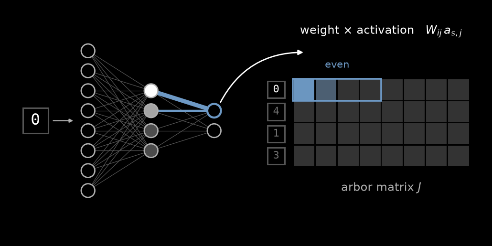
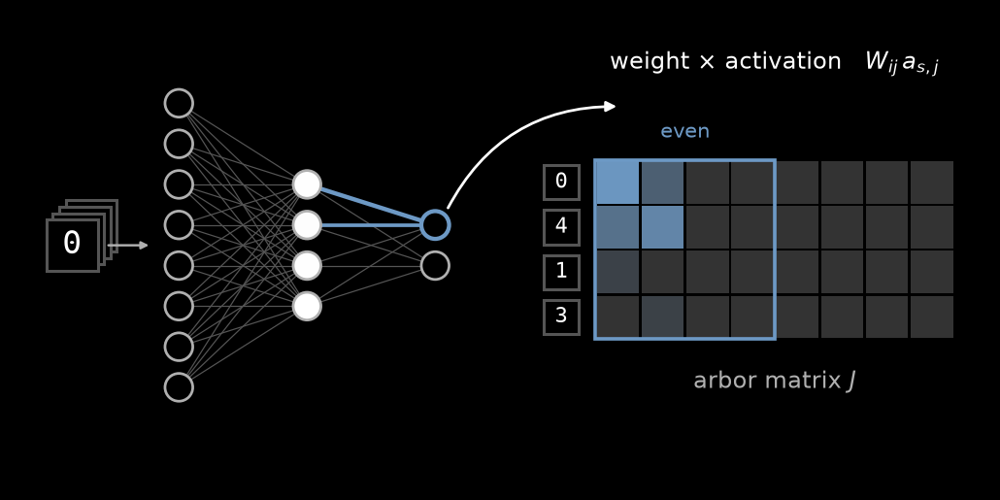
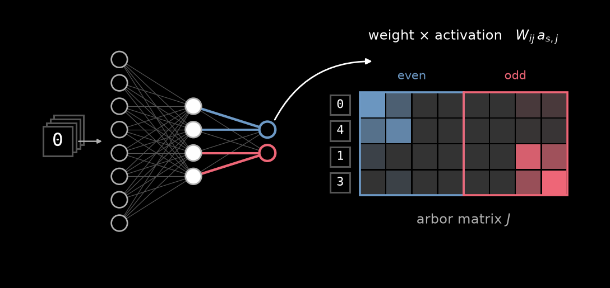

Builds: one stimulus into the even neuron, all stimuli, then the odd neuron's arbor appended as further columns.

**Notes:**

Build 1: Now the method step by step. Take one neuron, here the even output, and one stimulus, a 0. Instead of summing its inputs, we keep each incoming term, weight times activation, as a separate entry. That gives one row of numbers: the first row of the arbor matrix J, under the even neuron's block of columns.

Build 2: We do the same for every stimulus. Each stimulus is a row and each column is one incoming connection of the even neuron. The 0s and 4s drive it strongly through the first connections; the 1s and 3s barely drive it at all.

Build 3: And we do it for every neuron in the layer, appending the odd neuron's connections as further columns. The result is the arbor matrix of the layer: stimuli by connections, every entry a weight x activation term. It records not only which neurons respond, but through which connections.

**Comments:**

### nmf: NMF splits the arbor matrix into stimulus factors times connection factors

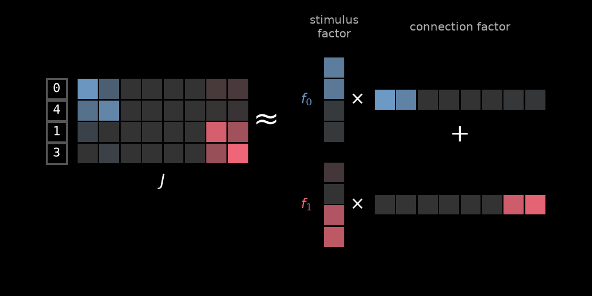

**Notes:**

We factorize the arbor matrix with non-negative matrix factorization. NMF writes it as a sum of a few rank-one parts, each a stimulus factor (which stimuli use this part) times a connection factor (which connections they use). Because everything is non-negative, the parts only add up and never cancel, which keeps each one readable. Here two factors suffice: f0 holds the 0s and 4s with the even connections, f1 the 1s and 3s with the odd ones. The negative terms, inhibition, are factorized separately in the same way.

**Comments:**

### nmf_math: NMF finds nonnegative factors that add up to the arbor matrix, the excitatory and inhibitory parts separately

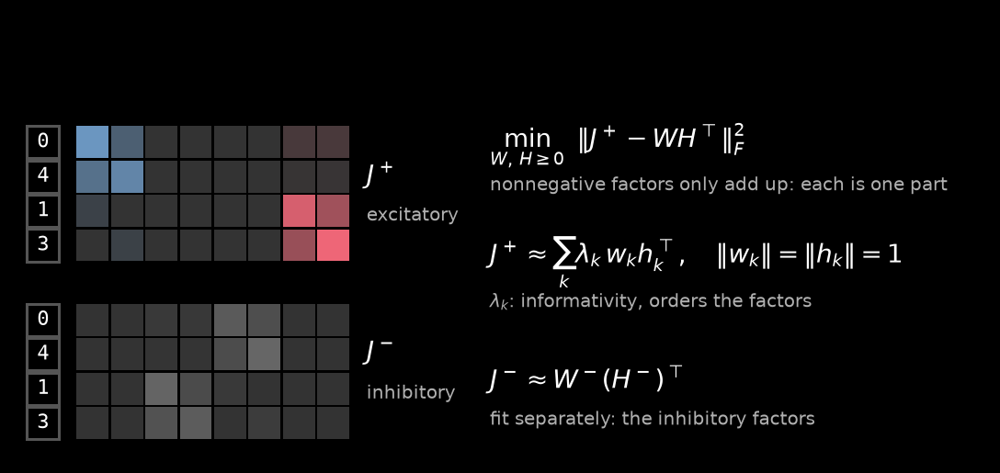

The nmf slide's $J^+$ at the same position, with $J^-$ (the products through negative weights, grey) below it. Right: the objective $\min_{W,H \geq 0} \|J^+ - WH^\top\|_F^2$; the unit-norm rewriting $J^+ \approx \sum_k \lambda_k w_k h_k^\top$, whose $\lambda_k$ (informativity) orders the factors; $J^-$ factorized on its own, giving the inhibitory factors. Toy $J^-$: the even neuron is inhibited by the odd stimuli and vice versa.

**Notes:**

Written out: the arbor matrix splits into an excitatory part, J plus, the products through positive weights, and an inhibitory part, J minus, the products through negative weights, shown in grey below. NMF finds non-negative W and H whose product approximates J plus in squared error. Since nothing can be subtracted, each factor is one additive part. We normalize every stimulus factor and connection factor to unit length, so each factor carries a scale lambda, its informativity, which orders the factors. J minus is factorized on its own in the same way and gives the inhibitory factors; in the toy, the even neuron is inhibited by the odd digits and the odd neuron by the even ones.

**Comments:**

### nmf_rank: the number of factors is where held-out reconstruction stops improving

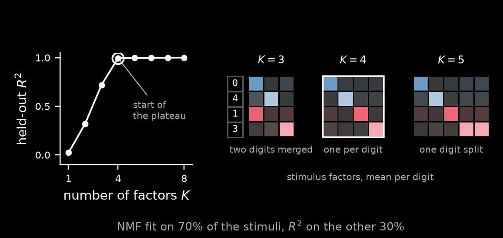

Toy: 200 noisy stimuli of the four digits, arbor matrix of the layer below the output (200 x 32). Left: held-out $R^2$ against $K$ (NMF fit on 70% of the stimuli, loadings of the other 30% refit on its connection factors); the paper's rule picks the smallest $K$ within 0.01 of the best, the start of the plateau, here $K = 4$. Right: mean stimulus factor per digit at $K = 3, 4, 5$: one rank fewer merges 0 and 1, one more splits the 3. In the paper this sweep sets the per-layer bound $k_\mathrm{max}$; each node is then fit once at $k_\mathrm{max}$ and trimmed by the gap in its $\lambda$ spectrum with a reconstruction floor (App. AutoNMF), which the slide leaves out.

**Notes:**

How many factors? We fit NMF on 70 percent of the stimuli and measure how well its factors reconstruct the other 30 percent. Held-out R-squared climbs with the number of factors and then plateaus; we take the smallest K within 0.01 of the best, the start of the plateau, here four. The right side shows why that is the right choice: with three factors the 0 and the 1 share a factor, with four there is one factor per digit, and a fifth factor only splits the 3 in two. In the paper this sweep sets an upper bound per layer, and each node then trims its factors further at a gap in its lambda spectrum.

**Comments:**

### simplification: for nonnegative inputs the arbor holds scaled copies of the activations, so a smaller matrix gives the same factors

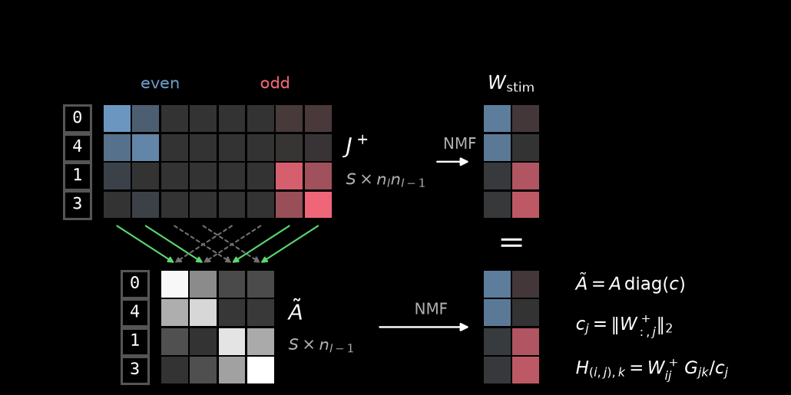

The rebuttal proposition (AI review W1), on the nmf slide's arbor matrix: each column $(i, j)$ of $J^+$ is activation column $j$ scaled by $W^+_{ij}$ (arrows; dashed where the weight is zero), so the stimulus x neuron matrix $\tilde A = A\,\mathrm{diag}(c)$ replaces it. Two separate NMF fits, one per matrix, give the same $W_\mathrm{stim}$, and the connection factor is read back per weight.

**Notes:**

In practice the arbor matrix is huge, with one column per weight. But for non-negative inputs, as after a ReLU, each column is just an activation column scaled by its weight (the arrows, dashed where the weight is zero). So we can factorize a much smaller matrix, stimuli by input neurons, with each activation column scaled by the norm of that neuron's outgoing weights. It gives the same stimulus factors, and the connection factor is read back per weight afterwards. Note that this is still not just activations: the weight scaling changes what NMF finds, and we test that directly in the results.

**Comments:**

### factor: each factor is a set of stimuli and the connections they use

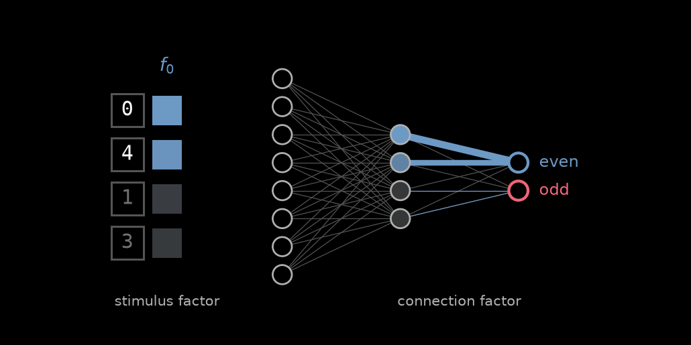
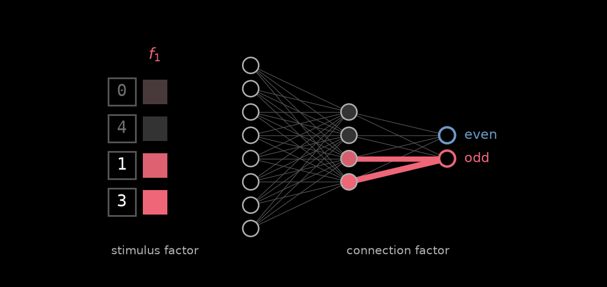

Builds: the even factor, then the odd one. Edge width is the connection factor, node fill its mass per hidden neuron.

**Notes:**

Build 1: This is what a factor looks like. On the left the stimulus factor: the 0 and the 4 load on f0, the 1 and the 3 do not. On the right the connection factor drawn on the network: edge width is the factor's weight on each connection, node fill its mass per hidden neuron. So f0 is an even circuit: the 0s and 4s, plus the two hidden units and connections through which they reach the even output.

Build 2: And the second factor, f1, is the odd circuit: the 1s and 3s, through the other two hidden units into the odd output. One factorization of one layer already separates the network's two decisions into two sets of stimuli, each with the connections it uses.

**Comments:**

### trace: a factor reweights the stimuli, and the layer below is factorized on them

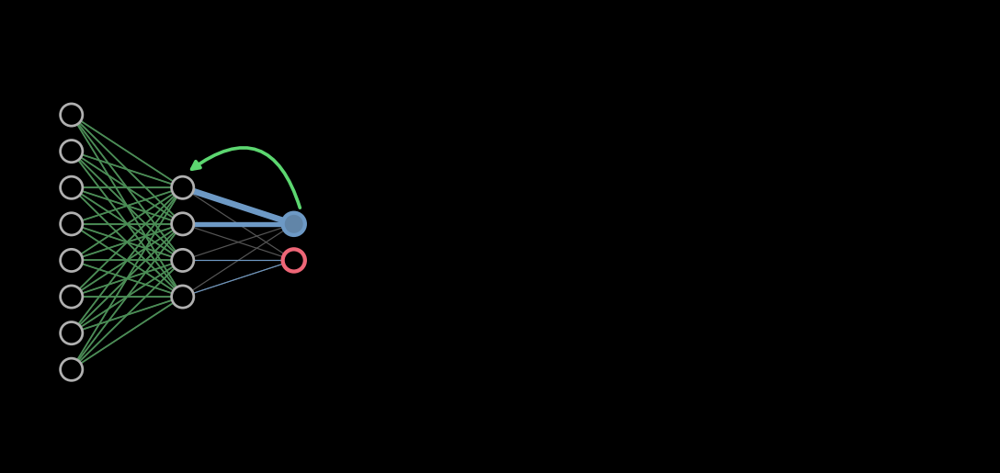
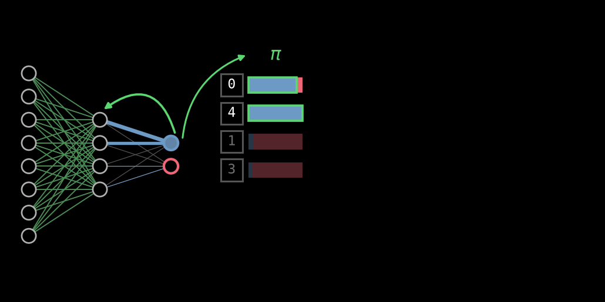
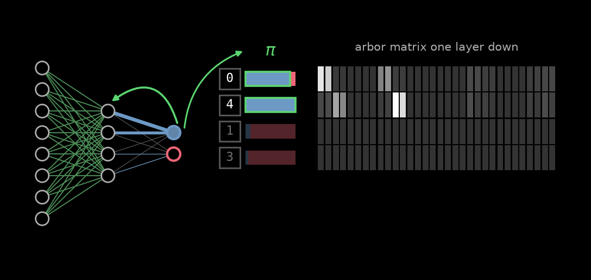
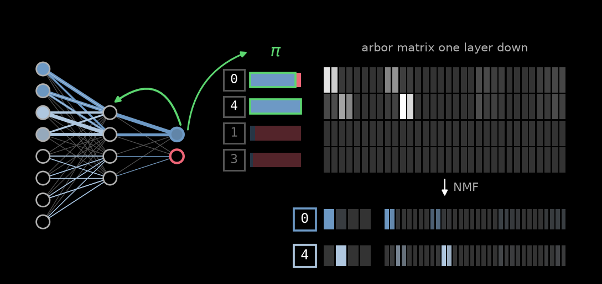

Build 1: the network only; the even factor traces back into the layer below (green). Build 2: $\pi$ comes from the even factor's stimulus loadings: each bar is a stimulus's loadings on the even (blue) and odd (red) factor, summed to one, and $\pi$ is the even share (green box); 1 and 3 fall below the $\tau$ gate. Build 3: $\pi$ scales the rows of the arbor matrix one layer down. Build 4: NMF of that matrix gives a "0" and a "4" factor, drawn on the hidden-1 connections.

**Notes:**

Build 1: To get a full circuit through the network, we trace each output factor backward. Take the even factor: we want to know how the layer below computes what feeds it. So we go one layer down (green) and factorize that layer's arbor, but only for the stimuli the even factor cares about.

Build 2: Which stimuli count is set by a weight pi. Each bar is one stimulus's loadings on the even (blue) and the odd (red) factor, normalized to sum to one; pi is the even share, boxed in green. The 0s and 4s get almost all of their weight from the even factor. The 1s and 3s fall below the tau gate and are dropped.

Build 3: pi then scales the rows of the arbor matrix one layer down. The stimuli that belong to the even factor dominate and the others are gone, so the next factorization only sees what the even circuit computes.

Build 4: NMF of that reweighted matrix splits the even circuit into two sub-circuits, a 0 factor and a 4 factor, each with its own connections in the first hidden layer. That is one step of the backward trace.

**Comments:**

### tree: repeating the step builds a factor tree

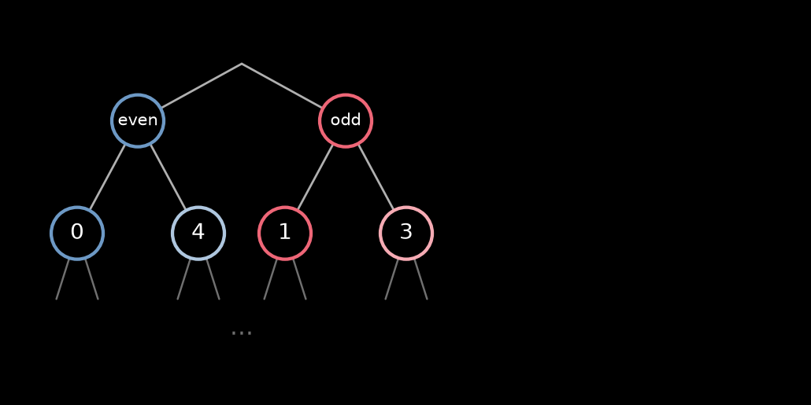

The tree as drawn on the fingerprint slides (now just before the fingerprint results), so the tree sits in the same place there.

**Notes:**

Repeating that step at every layer, for every factor, builds a tree. The root is the output layer, here split into even and odd. Each child is the factorization of the layer below under its parent's stimulus weights: even splits into 0 and 4, odd into 1 and 3, and so on down to the input. Each path through the tree is a circuit, a set of stimuli plus the connections they use at every layer. The number of factors per layer is chosen by held-out reconstruction, not by hand.

**Comments:**

### Results: the plan

From the paper's figures (main: Figs. 2, 4, 6, 8; appendix: A, B, E, G, N, P, fp_ood, fp_structure). All from `results.py`, drawn from the `figures/figdata/` bundles. The story, one message per slide:

1. **Circuits, small to large**: the even/odd MLP (Fig. 2a, c, d), the CIFAR-10 CNN (Fig. 6a, b), the pretrained ImageNet SqueezeNet (Fig. 8a, b). Same grammar each time: output factors are classes, one layer back they split into sub-groups.
2. **What changes with depth**: class purity falls to chance toward the input (Fig. 6d, 8d).
3. **The circuits are causal**: pruning the weights BFT ranks most important for a class, on all three models (Figs. 2e, 6f, 8c).
4. **The links of the trace are causal** (rebuttal): pruning a child factor's top weights silences its own parent factor, not the others.
5. **So are the sub-circuits** (rebuttal): the 0 vs. 4 sub-circuits of the even/odd MLP, the left- vs. right-facing horse and the two ship orientations of the CIFAR-10 CNN.
6. **Fingerprints**: class-structured (Fig. 4c) and more class-separable than the network's own activations (Fig. 4d, e, i).
7. **The weight term matters**: arbor NMF beats activation-only NMF on 5 of 5 models (Fig. P e); this is also the answer to "is it just activations?" after the simplification slide.
8. **Out of distribution**: held-out digits follow the network's own P(odd), and synthetic inputs collapse onto one fingerprint (Fig. fp_ood a, c).

The remaining results are backup slides at the end: the 10-digit MLP (Fig. B), the TinyViT (Fig. G), the full CNN and ImageNet galleries (Figs. E, N), conv1 color factors (Fig. 6c, e), faithfulness and stability (Fig. P a-c), rank sensitivity (Fig. P f), fingerprint baselines (Fig. P d), fingerprint class geometry (Fig. fp_structure a-e) and the OOD conditions (Fig. fp_ood f), then three rebuttal results: pruning baselines, the ImageNet tree on random held-out images, and the gate τ.

The rebuttal slides read the bundle `figures/figdata/rebuttal`, packed from the stored results of `rebuttal/exps/results/` by `.venv/bin/python scripts/build_rebuttal_bundle.py` (numbers and setups in `rebuttal/rebuttal_exps.md`, `rebuttal/exps/subcircuit_prune_mlp.md`, `rebuttal/exps/cnn_subcircuit_prune.md`).

**Comments:**

### mlp_circuits: the even/odd MLP splits into two near-disjoint class circuits that refine into digit detectors

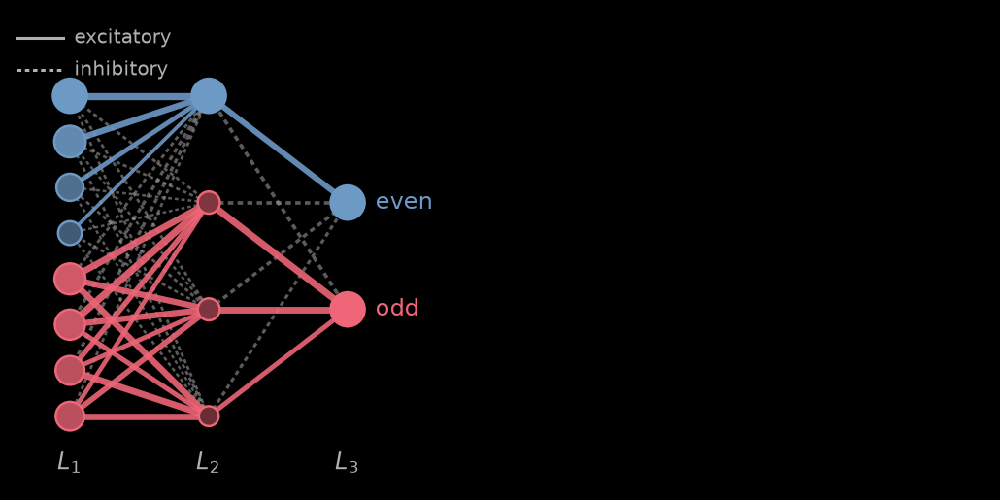
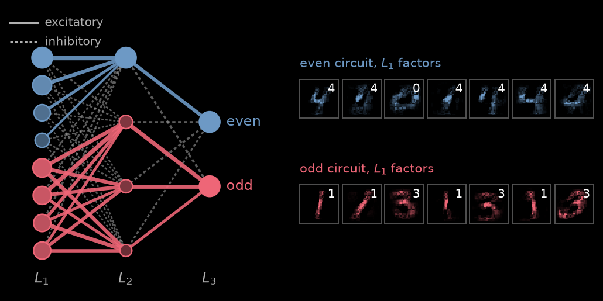

Fig. 2a, c, d. Build 1: both circuits in one graph (units grouped by circuit, node size = loading). Build 2: the $L_1$ factors of each circuit as pixel arbors, tagged with the digit each loads most.

**Notes:**

Build 1: Now the real even/odd MLP. Without labels, BFT splits it into two circuits, even in blue and odd in red, that share almost no units: each hidden unit belongs to one circuit. Node size is the loading; solid lines are excitatory, dotted ones inhibitory.

Build 2: Traced down to the pixels, each circuit refines into digit detectors. These are the first-layer factors of each circuit as pixel arbors, tagged with the digit that loads most: the even circuit's factors look like 4s and 0s, the odd circuit's like 1s and 3s. So the network computes parity by first detecting the individual digits and then pooling them.

**Comments:**

### mlp_inhibition: each circuit inhibits exactly where the other excites

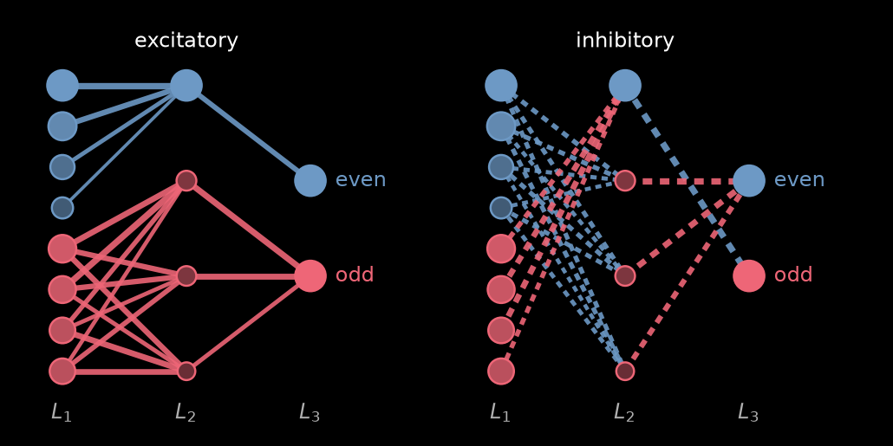

Fig. 2a split by sign, the same graph twice (left aligned with mlp_circuits): excitatory edges stay inside a circuit, inhibitory edges (colored by the circuit they come from) cross to the other one, the push-pull at the output.

**Notes:**

The same graph, split by sign. Left, the excitatory connections: they stay inside a circuit. Right, the inhibitory ones, colored by the circuit they come from: they cross over into the other circuit. Each circuit pushes its own output up and the other output down, a push-pull at the output.

**Comments:**

### cnn_circuits: on a CIFAR-10 CNN every output factor is a class, and one layer back it splits into appearance groups

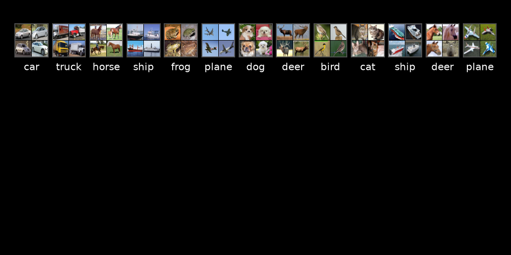
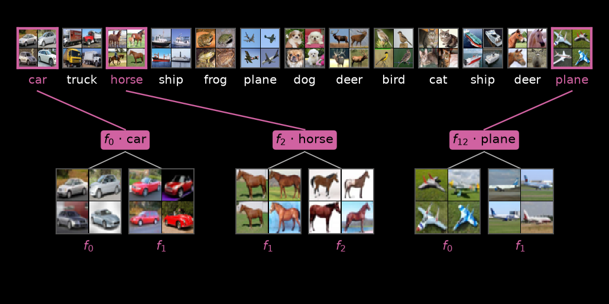

Fig. 6a, b. Build 1: the 13 output factors, top stimuli and top class. Build 2: car, horse and airplane traced one layer back (silver vs. red cars, horse poses, jets vs. airliners).

**Notes:**

Build 1: Next, a CNN trained on CIFAR-10. The output layer factorizes into 13 factors, shown with their top stimuli and the class that dominates them. Every factor is a class, again found without labels; three classes (ship, deer and plane) get a second factor.

Build 2: One layer back, each class circuit splits into appearance groups: the car circuit into silver and red cars, the horse circuit by pose, the plane circuit into jets and airliners. A class is assembled from several visually distinct sub-circuits.

**Comments:**

### imagenet_circuits: the same holds unchanged on a pretrained 1000-way SqueezeNet

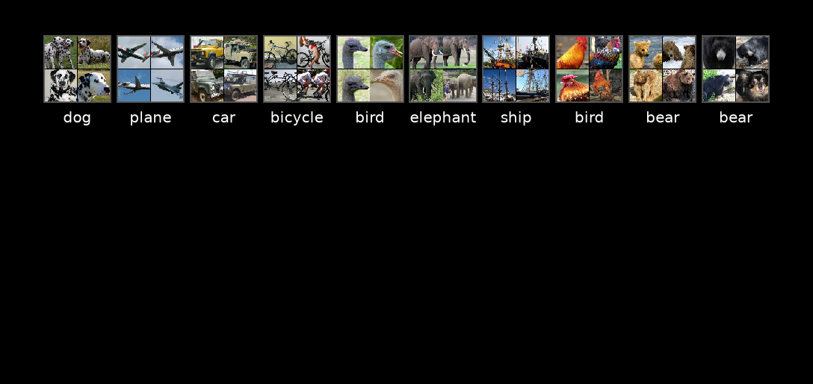
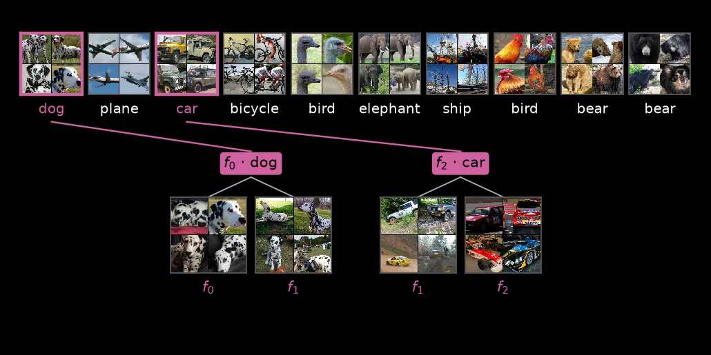

Fig. 8a, b. The 10 strongest output factors over 8 held-out categories; dog and car traced one fire module back.

**Notes:**

Build 1: The same method, unchanged, on a pretrained 1000-way SqueezeNet, evaluated on 8 coarse categories that each group several ImageNet classes. These are the 10 strongest output factors: each lines up with one category (dog, plane, car, bicycle, bird, elephant, ship, bear), even though these categories were never training targets.

Build 2: Traced back one fire module, the split again stays within the category and never crosses it. The dog circuit splits by scene, close-up dogs versus dogs in grass, and the car circuit into the category's two ImageNet classes, jeep and race car.

**Comments:**

### depth: class identity dissolves toward the input

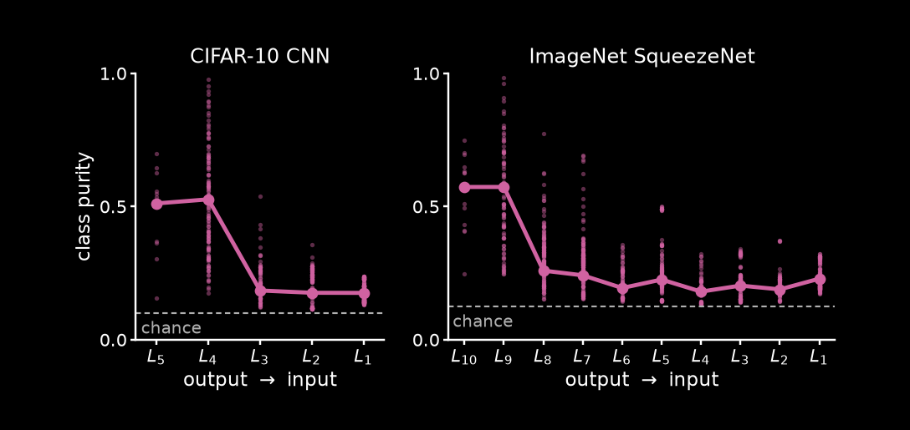

Fig. 6d, 8d. Class purity of every factor (dots) and the informativity-weighted mean (line), per layer.

**Notes:**

What changes as we trace toward the input? Class purity: how much of a factor's top stimuli come from one class. Each dot is a factor and the line is the informativity-weighted mean per layer. On CIFAR-10 purity is about 0.5 near the output and falls to 0.17 to 0.19 in the early layers, against a chance level of 0.1; on ImageNet it falls from 0.58 to about 0.2. Near the input the factors are shared features, not class detectors.

**Comments:**

### pruning: pruning the traced weights collapses the class

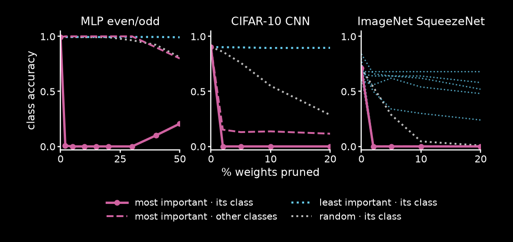

Figs. 2e, 6f, 8c. On ImageNet the most-important pruning is total rather than class-specific (both pink lines at zero), and least-important pruning is bimodal, so it is drawn per category.

**Notes:**

Are these circuits the ones the network actually uses? We prune a class circuit's weights in order of BFT importance and measure accuracy. Solid line: the circuit's own class, which collapses after only a few percent of the weights. Dashed: the other classes, which drop much less on the MLP and the CNN. Dotted: pruning the least important or random weights, which hurts far less. On ImageNet the ranking is causal but not class-specific: pruning one category's most important weights takes every category down at 2%. The least-important pruning is bimodal there, so it is drawn per category.

**Comments:**

### layer_link: a traced link is a real connection: pruning a child's top weights silences its own parent factor

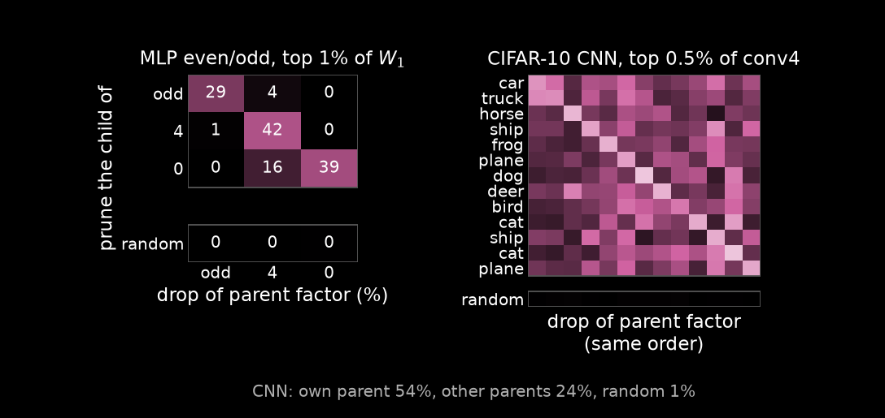

Rebuttal §1. Rows: the child whose highest-ranked weights are pruned; columns: the drop of each parent factor's contribution; below, the same number of random weights. Left: 8x4x2 MLP, the three $L_2 \to L_1$ links (odd, 4, 0), top 1% of $W_1$, values in %. Right: CIFAR-10 CNN, the 13 classifier factors and their conv4 children, top 0.5% of conv4; the own parent is the most-hit factor in all 13 rows (own 54%, other parents 24%, random 1%). The wider 40x20x10 MLP shows the same direction but weakly (specificity 0.06-0.07); not on the slide.

**Notes:**

Is a link in the tree a real connection or only a correlation? We test it causally. For each parent factor we prune the top-ranked weights of its child, one layer down, and measure how much each parent factor's contribution drops. In the even/odd MLP, pruning the top 1 percent of first-layer weights mostly silences the child's own parent, the diagonal, and the same number of random weights does nothing. In the CIFAR-10 CNN, with the 13 classifier factors and their conv4 children, the own parent is the most-hit factor in every row: on average a 54 percent drop for the own parent, 24 percent for the other parents and 1 percent for random weights.

**Comments:**

### subcircuit_mlp: pruning the 0 sub-circuit removes 0s and spares 4s and the odd digits

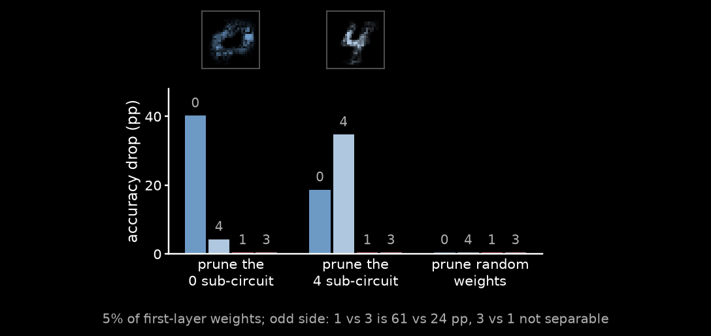

Rebuttal sub-circuit pruning, even/odd MLP. 5% of the first-layer weights, ranked by the factors whose stimuli are mostly 0 (or mostly 4), pos + neg; accuracy drop per digit on the test set. Above each group the strongest $L_1$ factor of that sub-circuit as a pixel arbor. 0: 40 vs. 4 pp; 4: 35 vs. 19 pp; odd digits ≤ 1 pp; random weights 0. The odd side (note line) is partial for 1 and fails for 3, as does a digit-supervised attribution baseline.

**Notes:**

Pruning also works below the class level. In the even/odd MLP the even circuit splits into a 0 and a 4 sub-circuit, found without digit labels. Pruning 5 percent of the first-layer weights ranked by the 0 sub-circuit costs the 0s 40 points of accuracy and the 4s only 4; ranked by the 4 sub-circuit, the 4s lose 35 points and the 0s 19. The odd digits are untouched, and random weights do nothing. The odd side is less clean: pruning the 1 sub-circuit hits the 1s harder than the 3s, 61 versus 24 points, but the 3 sub-circuit cannot be separated from the 1.

**Comments:**

### subcircuit_cnn: in the CNN, pruning the left-facing-horse sub-circuit hurts left-facing horses most

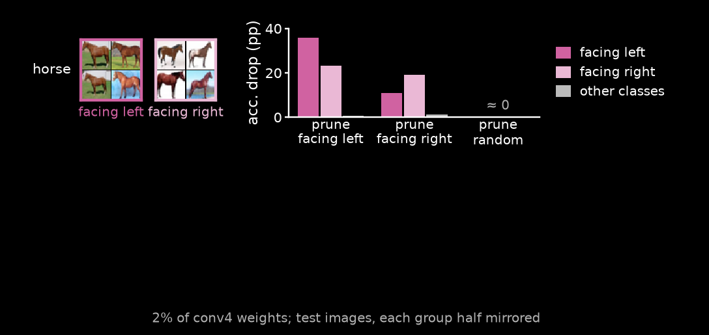
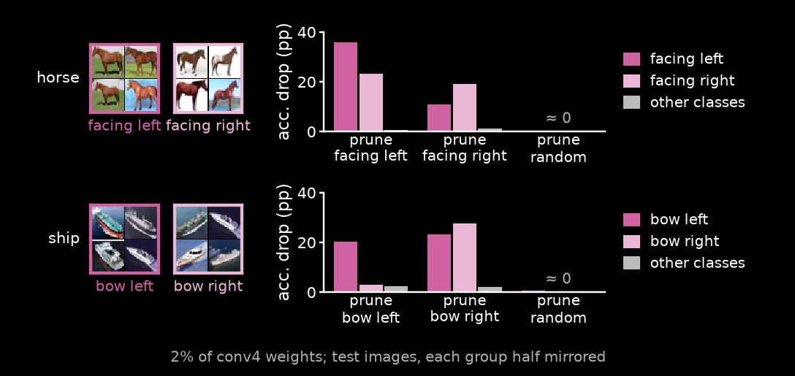

Rebuttal sub-circuit pruning, CIFAR-10 CNN. The horse circuit's conv4 node has a left-facing ($f_1$) and a right-facing ($f_2$) sub-factor, found label-free by a mirror test; the ship node ($f_1$, $f_3$) has two diagonal orientations. 2% of conv4 weights ranked by one sub-factor; drop on held-out test images of each orientation (each group is half originals, half mirrors of the other group, so only orientation differs) and on the other classes. Build 1: horse (36 vs. 23 pp, reversed 11 vs. 19 pp). Build 2: adds ship (20 vs. 3 pp; the reverse is barely selective, 23 vs. 28 pp).

**Notes:**

Build 1: The same works in the CIFAR-10 CNN, for sub-circuits that no label describes. The horse circuit's conv4 node splits into two sub-factors that a mirror test identifies as horses facing left and horses facing right. Each test group is half original images and half mirrored images of the other group, so only the facing direction differs. Pruning 2 percent of conv4 weights ranked by the left-facing sub-factor costs left-facing horses 36 points and right-facing ones 23; the right-facing sub-factor reverses this, 19 versus 11. Other classes and random weights barely move.

Build 2: The ship node splits by the direction of the bow. Pruning the bow-left sub-factor costs bow-left ships 20 points and bow-right ships only 3. The reverse is barely selective, 28 versus 23 points, so not every sub-factor gives a clean cut.

**Comments:**

### fingerprint: a stimulus's loadings across the tree are its fingerprint

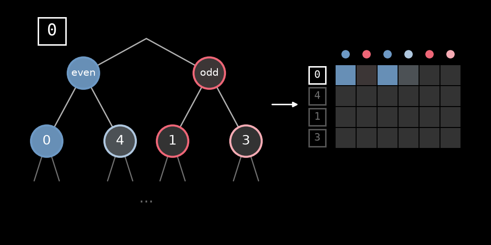
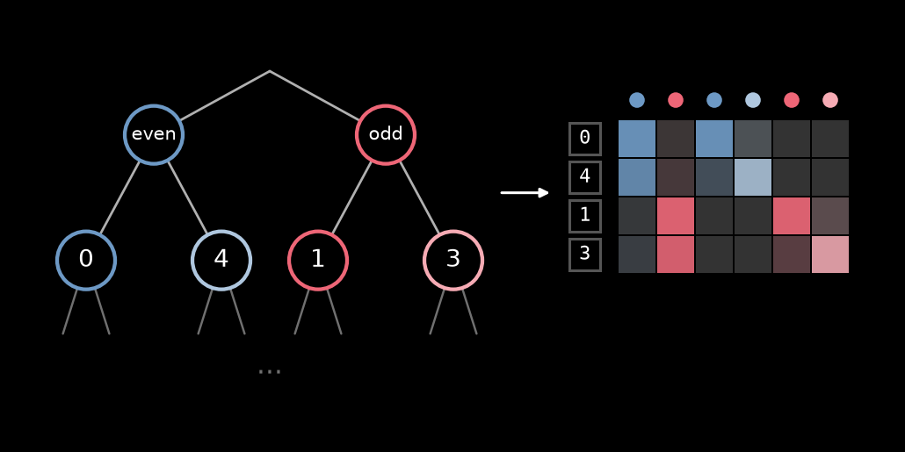

From `method.py`, moved here so the fingerprint method comes directly before the fingerprint results. Builds: the tree lit by one stimulus's loadings, then the fingerprints of all four stimuli. Toy loadings.

**Notes:**

Build 1: The tree also gives a code for each stimulus. Take a single 0: its loadings on the nodes of the tree's top two levels, even and odd and their sub-circuits, form a vector. That vector is the stimulus's fingerprint: it describes how this stimulus is routed through the network.

Build 2: Stacking the fingerprints of all four stimuli gives this matrix: the even digits load on the even side and their own sub-circuit, the odd digits on the odd side. A new stimulus can be projected onto the fixed factors without refitting, which we use later for held-out and out-of-distribution inputs. These are toy loadings; the real ones follow.

**Comments:**

### fingerprint_classes: on CIFAR-10 each class has its own fingerprint block

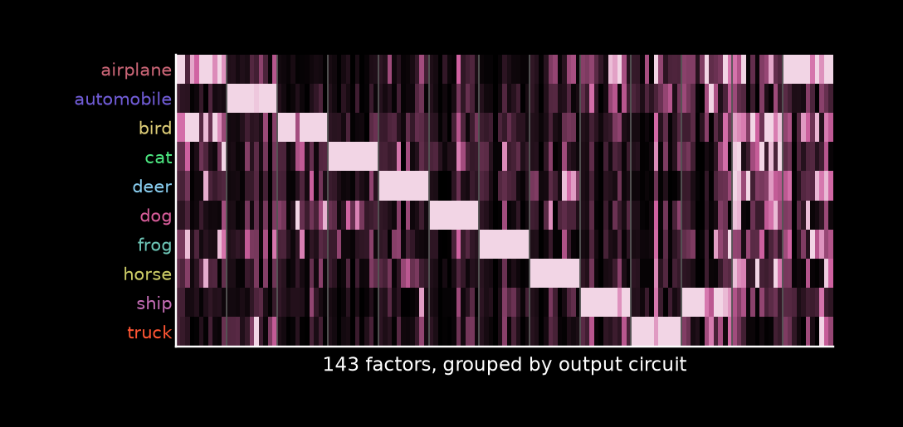

Fig. 4c. Mean fingerprint per class, factors grouped by output circuit, each column scaled to its top class; the three circuits beyond one per class (a second ship, deer and airplane) sit at the right. All 143 columns: the paper's Fig. 4c drops those three blocks (`_cnn_fp_blocks` keeps one circuit per class) while its label says 143.

**Notes:**

Back to the fingerprint, on the CIFAR-10 CNN. Each row is the mean fingerprint of one class; the columns are the 143 factors of the tree's top two levels, grouped by output circuit, each scaled to its top class. The matrix is block-diagonal: each class loads on its own circuit and that circuit's sub-factors. The three blocks at the right are the second circuits of ship, deer and airplane.

**Comments:**

### fingerprint_separability: the fingerprint separates classes better than the network's own activations

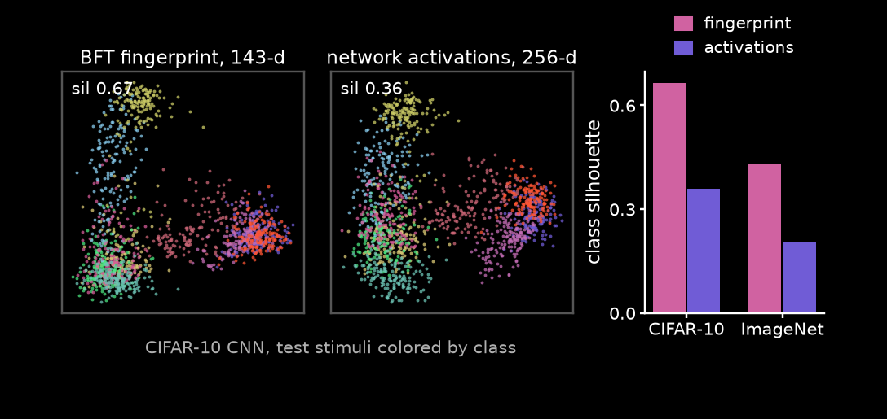

Fig. 4d, e, i. PCA of the CIFAR-10 fingerprint and penultimate activations; cosine silhouette for CIFAR-10 and ImageNet.

**Notes:**

How good is this as a class code compared with what one normally uses, the network's penultimate activations? Left, a PCA of both on the CIFAR-10 test set, colored by class: the fingerprint clusters are tighter. Right, the cosine silhouette: 0.67 versus 0.36 on CIFAR-10 and 0.43 versus 0.21 on ImageNet. On both convolutional models the fingerprint is the more class-separable code.

**Comments:**

### weight_term: factorizing weight x activation beats factorizing activations alone

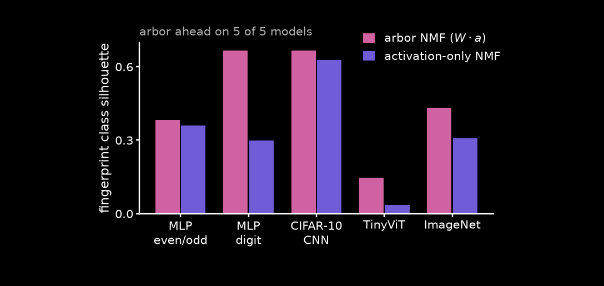

Fig. P e. The same NMF and fingerprint, on the arbor vs. on the activations, all five models.

**Notes:**

Is this just NMF on activations? We ran the same pipeline, node for node and at the same ranks, on the activations alone, without the weight term. On all five models the arbor version is more class-separable (one-sided Wilcoxon p = 0.031). The gap is largest on the MLPs and smaller, but never reversed, on the deeper networks. So the weights carry information that the activations alone do not.

**Comments:**

### ood: the fingerprint tracks what the network believes, and flags inputs it does not recognize

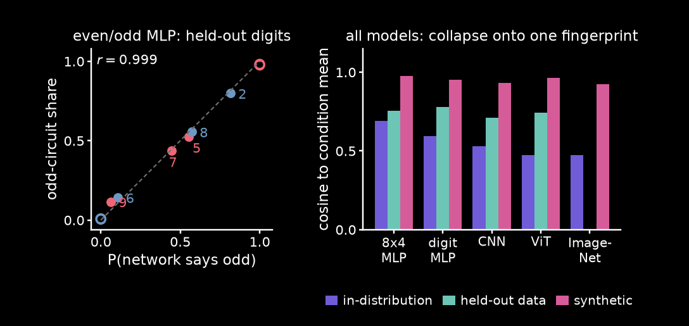

Fig. fp_ood c, a. Left: held-out digits land where the network's own P(odd) puts them, not at their true parity. Right: synthetic inputs (noise, gray, checkerboard, inverted) collapse onto one fingerprint on every model; ImageNet has no held-out set.

**Notes:**

Finally, out-of-distribution inputs. Left, the even/odd MLP on digits it never saw: their share on the odd circuit tracks the network's own probability of saying odd (r = 0.999), not their true parity. The fingerprint reflects what the network believes. Right, synthetic inputs (noise, gray images, checkerboards, inverted images) collapse onto almost the same fingerprint on every model, with cosine to their condition mean above 0.9, while real images stay spread out. That collapse flags inputs the network does not recognize. ImageNet has no held-out set, so that bar is missing.

**Comments:**

### bg_pipeline: to find background shortcuts, BFT compares each image with its bubble, and the factors that prefer bubbles are traced into the downsample path

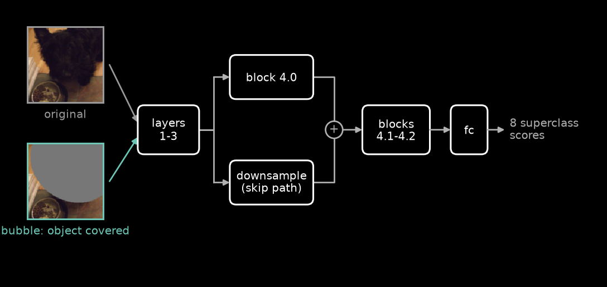
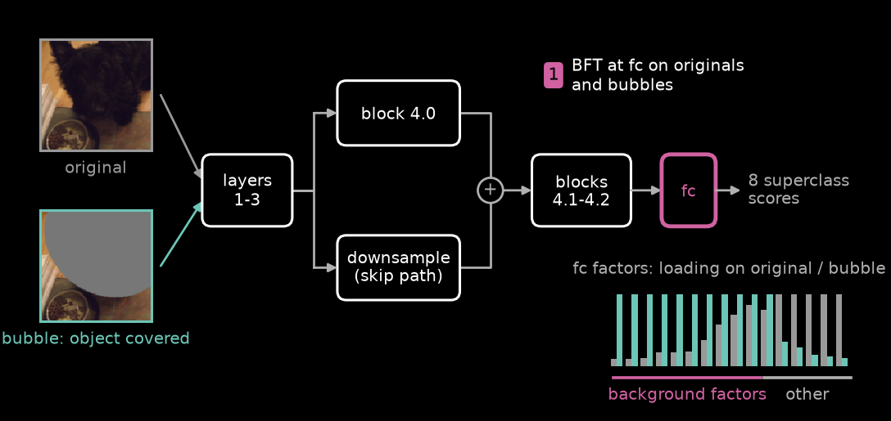
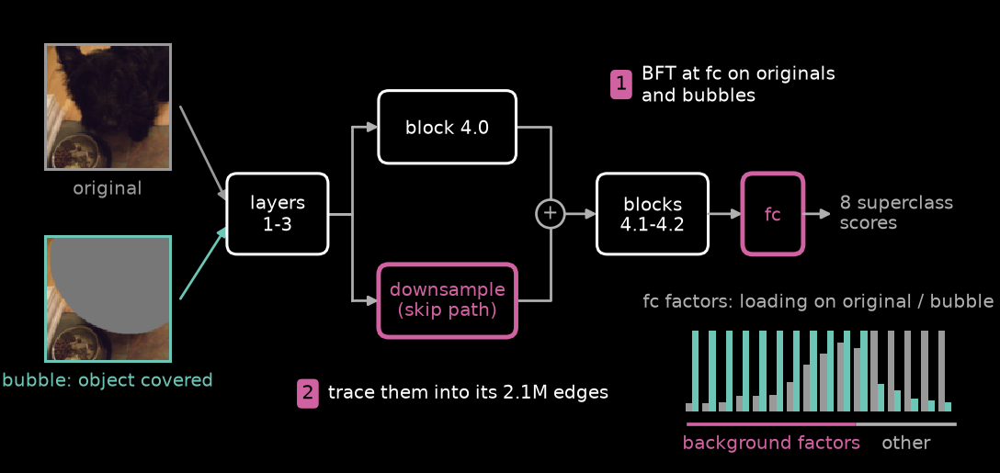
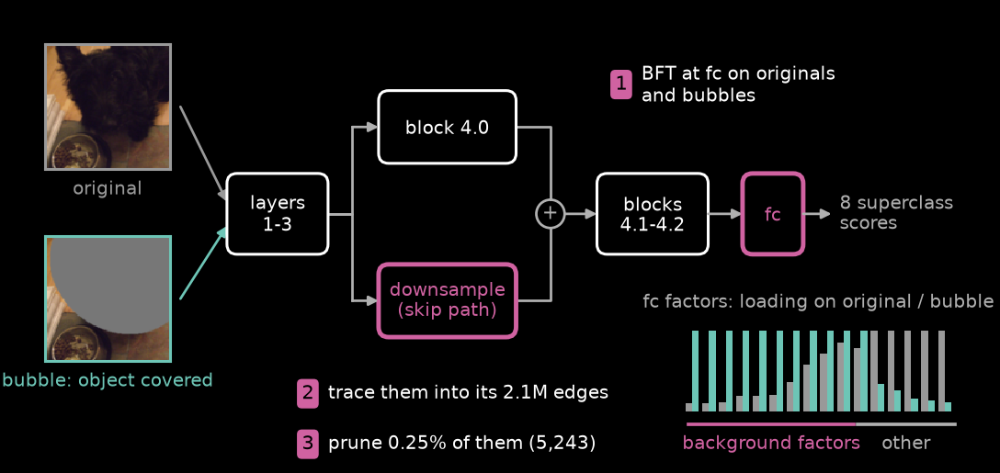

From `experiments/remove_background` (meeting 004; bundle `rmbg_downsample`, exported by `code/48_export_slides.py`). Pretrained ResNet-50, ImageNet validation images of 8 superclasses (airplane, bear, bicycle, bird, boat, car, dog, elephant). A bubble is the same image with the object covered by a gray ellipse. Builds: 1 an original and its bubble both go through the network; 2 BFT at fc on both together, with the mean loading of each of the 16 fc factors on the traced originals (grey) and on their bubbles (teal), each factor scaled to its larger value, sorted by background score; background factors = significantly more loading on the bubble than on its own original (paired test against a swap null); 3 the downsample conv of layer4.0 (1x1, stride 2, 1024 to 2048 channels), which reaches fc only through skip connections; 4 its top 0.25% edges pruned.

**Notes:**

Build 1: Now an application: can BFT find where a network classifies from the background instead of the object? We take a pretrained ResNet-50 and ImageNet images from eight superclasses, such as bird, boat and dog. For each image we also make a bubble: the same photo with the object covered by a gray ellipse, so only the background is left. Both go through the network.

Build 2: We run one BFT on the originals and their bubbles together, so every factor has a loading on each original and on its bubble. Here are all 16 factors at the last layer, grey the mean loading on originals, teal on the bubbles. On the left are factors that load more on the bubble than on the same image with its object: they respond to what is left when the object is gone, so these are background factors. On the right are the other factors; most of them load mainly on originals and carry the object.

Build 3: We trace the background factors one step further back, into the downsample path of the last block group. This is a skip path: it carries the layer-3 features into the residual stream without the block's convolutions. It has 2.1 million edges.

Build 4: Then we prune the top 0.25 percent of these edges, 5,243, ranked by how specific they are to the background factors.

**Comments:**

### bg_examples: typical traced bubbles keep a clear superclass score with the object fully covered

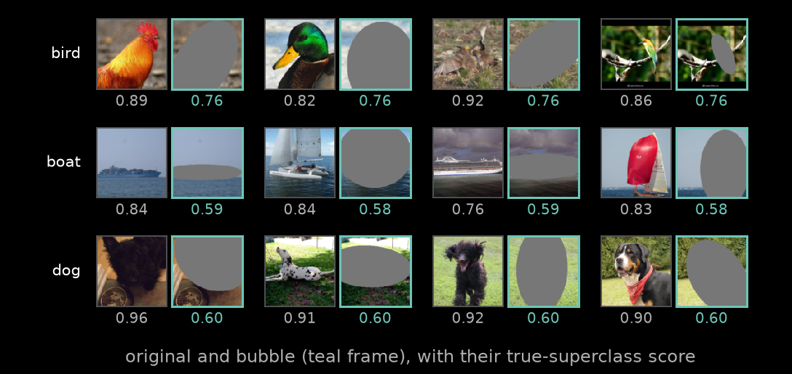

For bird, boat and dog, the four traced pairs whose bubble score is closest to that superclass's median. Numbers: true-superclass score of the original (grey) and the bubble (teal).

**Notes:**

We trace the bubbles that the network still assigns to the right superclass, with a score above what that superclass gets on other superclasses' bubbles: 683 of them, almost all dog, bird and boat. Here are typical examples, the median bubbles of each superclass. With the bird covered the network still says bird at 0.76: branches, ground and grass are enough. Boats are recognized from open water at 0.58, dogs from lawns and indoor floors at 0.6.

**Comments:**

### bg_factors: the background factors are scene types: grass, branches, sky

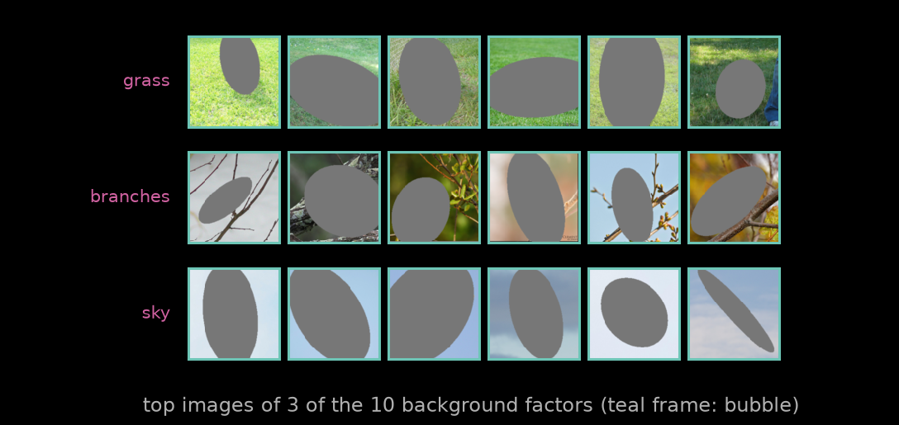

Top-loading stimuli of the three strongest of the 10 significant background factors (of 16) at fc; background score = paired bubble-minus-original loading, tested against a bubble/original swap null. All top stimuli are bubbles.

**Notes:**

What do the background factors look like? These are the top images of the three strongest. They are scene types, not objects: grass, branches and sky. All their top images are bubbles. These are the factors whose edges we trace into the downsample path.

**Comments:**

### bg_tradeoff: pruning the BFT-ranked downsample edges removes background evidence at almost no cost to the object

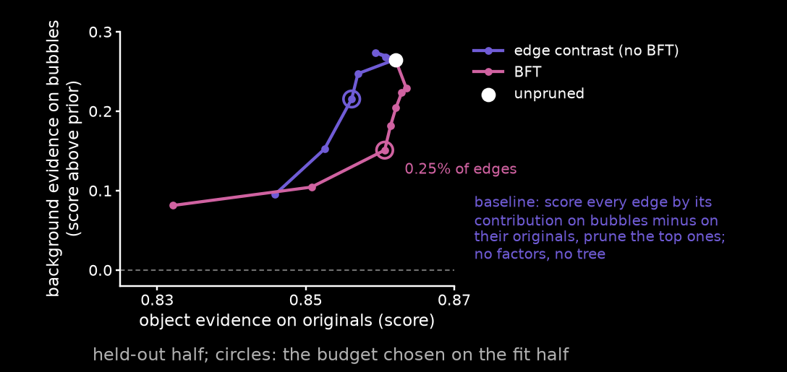

Held-out half. x: mean true-superclass score on originals (object evidence). y: background excess, the bubble's true-superclass score minus that superclass's prior, averaged over all bubbles (0 = no background evidence). Budgets 262 to 26,214 edges (0.0125% to 1.25%). Baseline: the paired edge contrast, the edge's contribution on bubbles minus on originals over all 2048 output channels, no BFT (`code/47_contrast_curve_ds.py`). Circles: the budget chosen on the fit half (largest with at most 0.01 original-score loss), 5,243 edges.

**Notes:**

Does pruning work? Up is background evidence on bubbles, right is object evidence on originals; the ideal is straight down. Pruning the top 0.25 percent of BFT-ranked edges cuts the background evidence from 0.26 to 0.15, 43 percent, while the originals stay at 0.86. The baseline, in blue, uses the same images and the same layer but no factorization. Each edge of the downsample path gets one number: its contribution averaged over the bubbles minus its contribution averaged over their originals. We prune the edges with the largest difference. So it asks which edges are used more without the object, while BFT asks which edges belong to the background factors and not to the others. At the same budget the baseline only gets to 0.22 and costs more object evidence. BFT removes more background evidence than the baseline at every budget; only at the largest budget, 1.25 percent, does it also cost more object evidence.

**Comments:**

### bg_percat: the pruning removes background evidence from bird, boat and dog, and the baseline much less

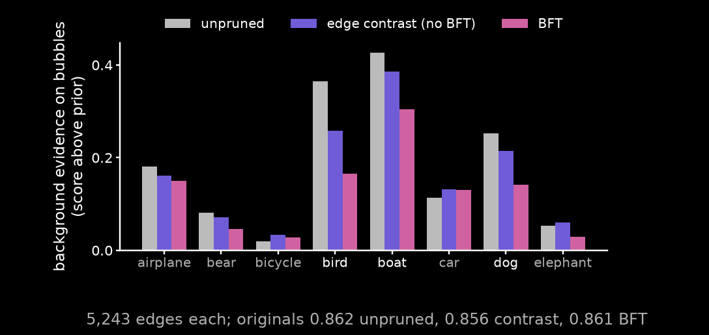

Held-out half, 5,243 edges each. Background excess per superclass; bird, boat and dog (white labels) are the superclasses with traced bubbles. Originals' mean true-superclass score in the note line.

**Notes:**

Per superclass: grey is the unpruned model, blue the contrast baseline, pink BFT, at the same number of edges. For the three traced superclasses BFT roughly halves the background evidence: bird from 0.36 to 0.17, dog from 0.25 to 0.14, boat from 0.43 to 0.30. The baseline removes much less. The originals keep their score: 0.862 before, 0.861 after.

**Comments:**

### Backup slides

All from `results.py`, after the main results.

#### backup_digit_mlp: on ten digits, output factors pool several digits and tracing back un-pools them

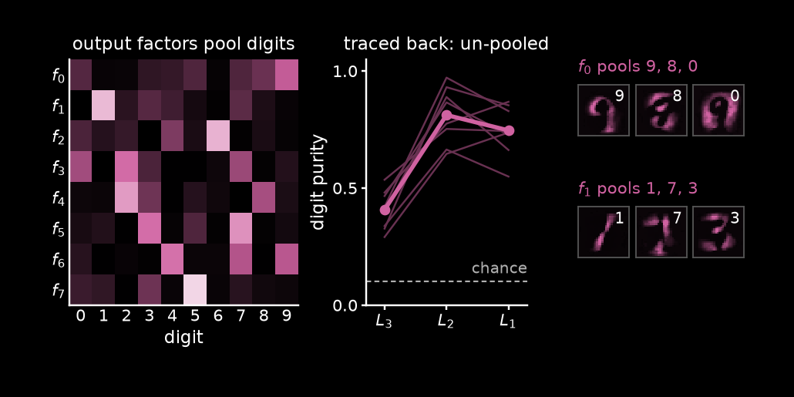

Fig. B a, b, g. Output factor x digit share; best digit purity per circuit from $L_3$ to $L_1$; the $L_1$ detector of each digit pooled by $f_0$ and $f_1$.

**Notes:**

Backup: a 784-40-20-10 MLP on all ten digits. Left, the output factors do not map to single digits; each pools several, and the largest digit share is only 0.28 to 0.54. Middle, tracing a circuit back un-pools them: digit purity rises toward the input. Right, an example: f0 pools 9, 8 and 0, and its first-layer factors are separate detectors for each of those digits.

**Comments:**

#### backup_vit: a TinyViT block traces like an MLP, its circuits pooling similar digits along parity

Fig. G b, f. Output circuit x digit (label color: the parity it leans to) and the strongest stimuli of each circuit.

**Notes:**

Backup: a TinyViT trained on even versus odd. BFT factorizes the block's projections like MLP layers. Each output circuit pools a few similar-looking digits; the digit labels are colored by the parity they lean to. Right, the strongest stimuli of each circuit, each dominated by one or two digit shapes.

**Comments:**

#### backup_cnn_gallery: every CIFAR-10 class circuit and its two strongest sub-factors

Fig. E. The strongest output factor of each class, its top stimuli, and the top stimuli of its two strongest sub-factors one layer back.

**Notes:**

Backup: the full CIFAR-10 gallery. For each class, the strongest output factor with its top stimuli, and below it the top stimuli of its two strongest sub-factors one layer back. Every class splits into appearance groups, like the cars and horses on the main slides.

**Comments:**

#### backup_imagenet_gallery: the same on ImageNet

Fig. N. One circuit per category (8 categories).

**Notes:**

Backup: the same gallery for the SqueezeNet, one circuit for each of the eight categories, with its two strongest sub-factors one fire module back. The sub-factors stay within their category and split it by scene, view or subclass, for example bear species and airplane views.

**Comments:**

#### backup_conv1: at conv1 the factors are color channels

Fig. 6c, e. The conv1 factors under the cat circuit with their input mass per RGB channel; the color spread of each layer's top stimuli falls toward the input.

**Notes:**

Backup: what happens at the very first layer. Left, the conv1 factors under the cat circuit, with their input mass per RGB channel as the colored strip: they are largely color channels. Right, the color spread of each layer's top stimuli falls toward the input and stays below random, so the early factors group stimuli by color, not by class.

**Comments:**

#### backup_validation: the decomposition is faithful and stable

Fig. P a-c. Causal reconstruction $R^2$, NNLS round-trip and NMF-seed stability per model; n/a where a model cannot supply the measure.

**Notes:**

Backup: is the decomposition faithful? Left, causal reconstruction R-squared, how much of each node's pre-activation the factors reconstruct: 0.96 and 0.72 on the two MLPs, n/a where a model cannot supply the measure. Middle, the NNLS round-trip: held-out stimuli re-projected onto the fixed factors keep a median cosine of 0.74 to 1.0. Right, stability across NMF seeds: 0.86 to 0.95, all above our 0.85 gate.

**Comments:**

#### backup_rank: the factors barely depend on the exact rank

Fig. P f. Cosine of each node's factors at $K^* \pm 1$ to those at $K^*$ (dots: nodes, bar: median).

**Notes:**

Backup: sensitivity to the rank. For every node we refit with one factor fewer and one more than the chosen rank K* and compare the factors with those at K*. The cosine stays near 1 on all five models (dots are nodes, bars the median), with one outlier at K* - 1 on the even/odd MLP.

**Comments:**

#### backup_fp_baselines: the fingerprint against activation baselines at matched width

Fig. P d. On the even/odd MLP the matched-width activations beat the fingerprint (3 of 5 models in favor of the fingerprint, as in the paper).

**Notes:**

Backup: the fingerprint against more baselines: the network's activations at native width, reduced by PCA to the fingerprint's width, and randomly projected to that width. The fingerprint is clearly better on 3 of 5 models (digit MLP, CIFAR-10 CNN and ImageNet). On the even/odd MLP the matched-width activations beat it, and on the TinyViT all codes are about equal.

**Comments:**

#### backup_fp_geometry: on every model the fingerprint geometry is block-diagonal by class

Fig. fp_structure a-e. Pairwise cosine of 30 test fingerprints per class (digit for the parity models), sorted by class; silhouette on all test fingerprints.

**Notes:**

Backup: the fingerprint's class geometry on every model. Pairwise cosine between 30 test fingerprints per class, sorted by class (by digit for the two parity models): block-diagonal throughout. The silhouette on the full test set is under each matrix.

**Comments:**

#### backup_ood_conditions: synthetic inputs load a few factors, real images spread over all circuits

Fig. fp_ood f. CIFAR-10 mean fingerprint per condition.

**Notes:**

Backup: where the OOD collapse comes from, on CIFAR-10. This is the mean fingerprint per condition over the 143 factors. Test images and CIFAR-100 images spread over all circuits; noise, gray, checkerboard and inverted images load on only a few factors, so they all end up at nearly the same fingerprint.

**Comments:**

#### backup_prune_baselines: BFT pruning is far more class-specific than magnitude and on par with weight x activation; gradient and relevance rankings are often more specific

Rebuttal §2. Whole-network class pruning, specificity = mean relative target drop minus bystander drop over 0.1-20% of the weights; each baseline in its better normalization (per-layer or global); bars plain ranking, white ticks the class-contrastive variant (target minus other classes).

**Comments:**

#### backup_imagenet_heldout: the frozen ImageNet tree names the super-category on random held-out images, also where the network is wrong

Rebuttal §3. Root call (category with the largest λ-weighted root loading) vs. the network's top-1 prediction mapped to its super-category, with 95% bootstrap CIs. Misclassified: all 256 other val images of the 16 traced classes; unseen classes: 1100 val images of 188 other classes of the 8 super-categories; train set: 100 train images per traced class.

**Comments:**

#### backup_tau: the gate τ leaves class pruning and the fingerprint unchanged

Rebuttal §6. Retraced trees at τ ∈ {0, 0.25, 0.5, 0.7, 0.9}; rings mark each model's paper τ. Left: class-pruning drop of the target class (solid) and of the other classes (dashed). Right: fingerprint class silhouette (even/odd for the 8x4x2 MLP). Deeper factors and their class purity do change with τ (note line).

**Comments:**

## Paper
